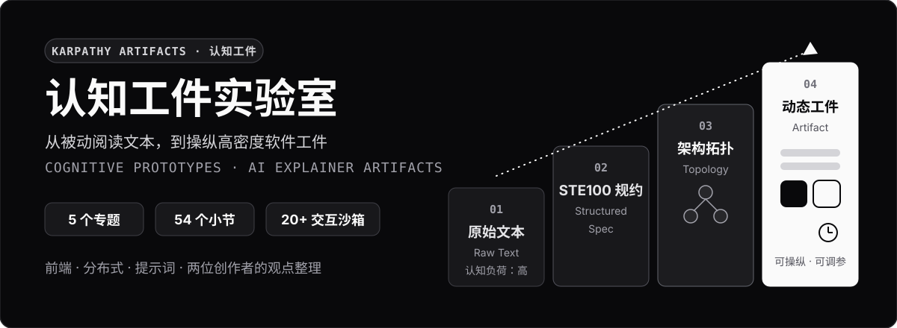

<p align="right"><a href="README.md">中文</a></p>

<p align="center">
  
</p>

<p align="center">
  <a href="https://karpathy-deep-explainer-artifacts.xiaosang.cc/">▶ Explore Online</a>
  ·
  <a href="https://github.com/holynova/karpathy-deep-explainer-artifacts">GitHub Repository</a>
</p>

Cognitive Artifacts Lab is a set of interactive learning pages inspired by Andrej Karpathy's observation: as code and intelligence become abundant, human work shifts from writing boilerplate to oversight and understanding — we no longer need generic answers, but custom, manipulable software artifacts with real physics and parameters. This repo holds 5 such artifacts: frontend systems, distributed systems, prompt engineering, and two creators' collected insights.

## Screenshot

<p align="center">
  
</p>

## The 5 Artifacts

| Artifact | Content (8 sections per page) |
| :--- | :--- |
| [Frontend System Design](./frontend-system-design.html) | Micro-frontends and Module Federation, SSR/SSG/ISR/RSC/Islands rendering paradigms, Signals vs XState state architecture, code-splitting strategy, Local-First and CRDT, stability and self-healing, RUM monitoring, design-system engineering |
| [System Design & Distributed Architecture](./backend-system-design.html) | Raft consensus, consistency models and PACELC, Saga and Outbox + CDC, LSM-Tree vs B+ Tree, cache double-writes, consistent hashing, rate-limiting algorithms, Kafka and Exactly-Once |
| [Prompt Engineering](./prompt-engineering.html) | Dynamic example retrieval, CoT/ToT/MCTS reasoning topologies, grammar-constrained decoding, DSPy prompt compilation, ReAct and self-healing loops, context-window physics, ASD-STE100 controlled language, defense-in-depth prompt security |
| [Zara Zhang Insights](./zara-zhang-insights.html) | Build for One, the potted-plant mindset and anti-planning, Vibe Coding, unlearning, writing as thinking, humble AI, a ladder-free career |
| [Matt Pocock Insights](./matt-pocock-insights.html) | Engineering over vibe coding, the 「审问我」 ("grill me") technique, vertical slices and TDD, day-shift / night-shift mental models, TypeScript as guardrails, Agent Skills, shared design consensus |

54 sections and 20+ interactive controls (buttons, sliders, inputs) in total; each artifact is a standalone single page you can open directly.

## Homepage Sandbox: 4 Stages of Information Output

The homepage has a switchable evolution sandbox that presents the same token-bucket algorithm in 4 stages of information output (switch with keys 1–4 or the floating markers below):

1. **Raw text** （原始文本）: a plain natural-language paragraph — high cognitive load; the reader must read every word and build the structure in their head.
2. **STE100 spec** (STE100 规约）: rewritten in a controlled language — clear structure, verifiable.
3. **Architecture topology** （架构拓扑）: a diagram of the structure — relationships at a glance.
4. **Dynamic artifact** （动态工件）: an interactive model with tunable parameters — change a parameter and watch the system respond.

## Run Locally

Zero build, pure static pages (Tailwind loads via CDN, so styles need internet):

```bash
python3 -m http.server 8080
# Open http://localhost:8080
```

## Tech

- 6 standalone HTML files, zero build, zero dependencies (apart from the Tailwind CDN and an analytics script); each topic page carries its own diagrams and interactive experiments.
- Design follows Emil Kowalski's design-engineering standards: dark zinc background, restrained motion, keyboard-reachable.

```
index.html                      Lab homepage: Karpathy quote + 4-stage evolution sandbox + 5 artifact entrances
frontend-system-design.html     Frontend System Design (8 sections)
backend-system-design.html      System Design & Distributed Architecture (8 sections)
prompt-engineering.html         Prompt Engineering & Cognitive Architecture (8 sections)
zara-zhang-insights.html        Zara Zhang's ideas and mental models (8 sections)
matt-pocock-insights.html       Matt Pocock's engineering philosophy (8 sections)
assets/readme/screenshot.png    Homepage screenshot (old, kept)
```

## Note

The insights pages are the author's study notes, not reviewed by the people featured and not their complete body of thought. The interactive models are for learning, not production system implementations.
