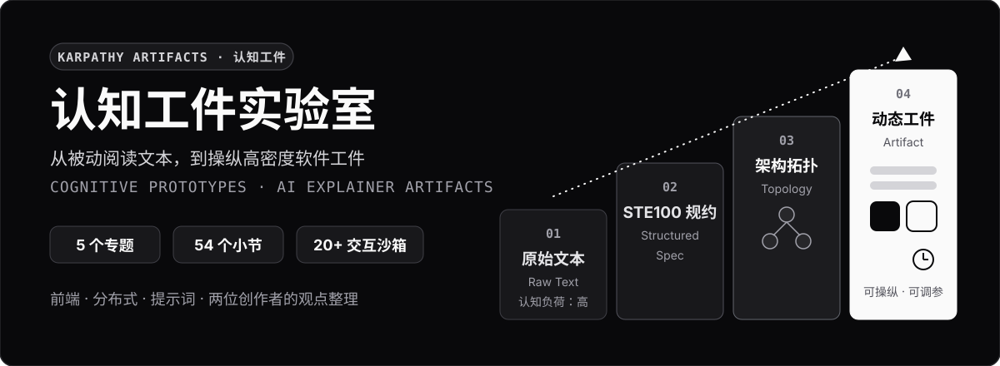
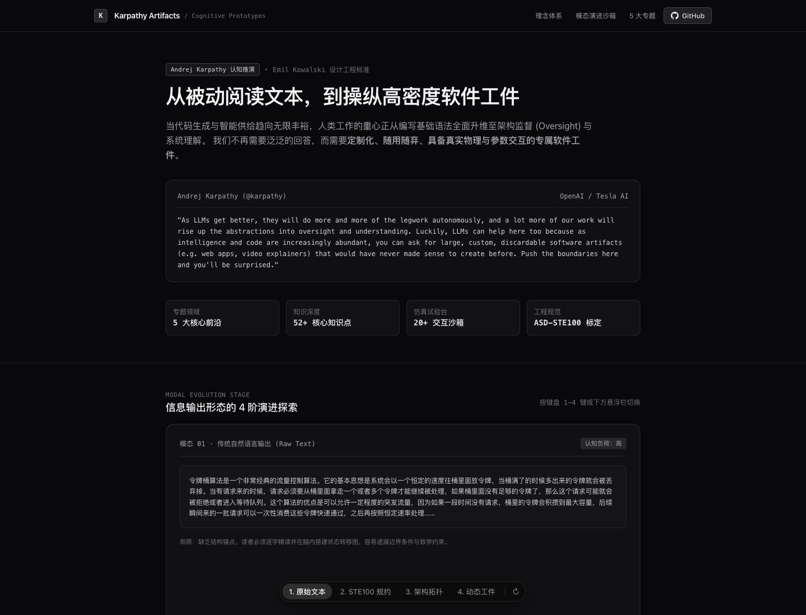

<p align="center">
  
</p>

<p align="center">
  <a href="https://karpathy-deep-explainer-artifacts.xiaosang.cc/">▶ 在线探索 Explore Online</a>
  ·
  <a href="https://github.com/holynova/karpathy-deep-explainer-artifacts">GitHub 仓库</a>
</p>

认知工件实验室是一组交互式学习页面，灵感来自 Andrej Karpathy 的观点：当代码与智能供给无限丰裕，人类工作的重心正从编写基础语法，全面升维至架构监督与系统理解——我们不再需要泛泛的回答，而需要定制化、可操纵、带真实物理与参数交互的专属软件工件。这里有 5 个这样的工件：前端、分布式系统、提示词工程，以及两位创作者的观点整理。

Cognitive Artifacts Lab is a set of interactive learning pages inspired by Andrej Karpathy's observation: as code and intelligence become abundant, human work shifts from writing boilerplate to oversight and understanding — we no longer need generic answers, but custom, manipulable software artifacts with real physics and parameters. This repo holds 5 such artifacts: frontend systems, distributed systems, prompt engineering, and two creators' collected insights.

## 截图 / Screenshots

<p align="center">
  
</p>

## 5 个专题工件 / The 5 Artifacts

| 工件 | 内容（每页 8 个小节） |
| :--- | :--- |
| [前端系统设计](./frontend-system-design.html) | 微前端与 Module Federation、SSR/SSG/ISR/RSC/Islands 渲染范式、Signals vs XState 状态架构、分包策略、Local-First 与 CRDT、稳定性与自愈、RUM 监控、设计系统工程化 |
| [系统设计与分布式架构](./backend-system-design.html) | Raft 共识、一致性模型与 PACELC、Saga 与 Outbox + CDC、LSM-Tree vs B+ Tree、缓存双写、一致性哈希、限流算法、Kafka 与 Exactly-Once |
| [提示词工程](./prompt-engineering.html) | 动态示例检索、CoT/ToT/MCTS 推理拓扑、语法约束解码、DSPy 提示词编译、ReAct 与自愈闭环、上下文窗口物理学、ASD-STE100 受控语言、提示词安全纵深防御 |
| [Zara Zhang 观点整理](./zara-zhang-insights.html) | Build for One、盆栽心态与反规划、Vibe Coding、反向学习、写作即思考、谦逊的 AI、无阶梯职业生涯 |
| [Matt Pocock 工程观点](./matt-pocock-insights.html) | 工程化而非氛围编程、「审问我」技术、垂直切片与 TDD、白班/夜班心智模型、TypeScript 安全护栏、Agent Skills、共享设计共识 |

共 54 个小节、20 多处可交互控件（按钮、滑杆、输入框），每个专题都是独立单页，可直接打开。

## 首页沙箱：信息输出形态的 4 阶演进 / Modal Evolution Sandbox

首页有一个可切换的演进沙箱，用同一个令牌桶算法，演示信息输出形态的 4 个阶段（按键盘 1–4 或点下方浮标切换）：

1. **原始文本**：纯自然语言段落，认知负荷高，读者必须逐字精读并在脑内搭建结构。
2. **STE100 规约**：受控语言重写，结构清晰、可校验。
3. **架构拓扑**：图解结构，关系一目了然。
4. **动态工件**：可调参、可操纵的交互模型，动手改参数看系统如何响应。

## 本地运行 / Run Locally

零构建，纯静态页面（Tailwind 走 CDN，需联网加载样式）：

```bash
python3 -m http.server 8080
# 打开 http://localhost:8080
```

## 技术 / Tech

- 6 个独立 HTML 文件，零构建、零依赖（除 Tailwind CDN 与统计脚本）；每个专题页自带图解与交互实验。
- 设计参考 Emil Kowalski 的设计工程标准：深色 zinc 底、克制动效、键盘可达。

```
index.html                      实验室首页：Karpathy 引言 + 4 阶演进沙箱 + 5 工件入口
frontend-system-design.html     前端系统设计（8 小节）
backend-system-design.html      系统设计与分布式架构（8 小节）
prompt-engineering.html         提示词工程与认知架构（8 小节）
zara-zhang-insights.html        Zara Zhang 思想与认知模型（8 小节）
matt-pocock-insights.html       Matt Pocock 技术哲学与工程体系（8 小节）
assets/readme/screenshot.png    首页截图（旧，保留）
```

## 说明 / Note

观点页面是项目作者的学习整理，不代表人物本人审核或完整思想体系。交互模型用于学习，不是生产系统实现。

## English

**Cognitive Artifacts Lab** is a collection of interactive learning pages built on Andrej Karpathy's idea: with code and intelligence abundant, the work shifts to oversight and understanding — what we need is not generic answers but custom, manipulable software artifacts.

- **5 standalone artifacts, 54 sections, 20+ interactive controls**: Frontend System Design (micro-frontends, rendering paradigms, Signals vs XState, CRDTs, RUM); System Design & Distributed Architecture (Raft, consistency models, Saga/Outbox, LSM vs B+ Tree, consistent hashing, rate limiting, Kafka); Prompt Engineering (in-context retrieval, CoT/ToT/MCTS, constrained decoding, DSPy, ReAct loops, context-window physics, ASD-STE100, prompt security); Zara Zhang Insights (Build for One, potted-plant mindset, Vibe Coding, unlearning); Matt Pocock Insights (engineering not vibe coding, "grill me", vertical slices & TDD, TypeScript as guardrails, Agent Skills).
- **Modal Evolution Sandbox** (homepage): the same token-bucket algorithm presented in 4 stages — raw text, STE100 controlled-language spec, architecture topology, interactive artifact — switchable with keys 1–4.
- **Run it**: `python3 -m http.server 8080` — no build step, no dependencies (Tailwind via CDN, needs internet for styles).
- **Note**: the insights pages are the author's study notes, not reviewed by the people featured; the interactive models are for learning, not production implementations.

## 许可 / License

仓库内暂无 LICENSE 文件。
